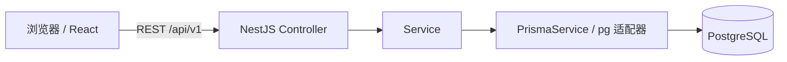

# 系统架构与技术选型

## 第一阶段边界

本阶段交付可编译、可启动的前后端基础工程、管理后台界面、健康检查、数据库访问基础与初始组织模型。登录仅为 UI，没有认证、业务 CRUD、RBAC 或审计接口。公开预览页面不代表拥有任何企业权限。

## 分层与通信

Vite 在开发环境将 `/api` 代理至 NestJS。生产部署由 Nginx 或其他反向代理提供静态页面、SPA 回退和 API 转发。前端所有业务请求通过 Axios 实例；TanStack Query 管理服务端数据、请求取消与刷新；Zustand 仅管理侧栏等界面状态，不能用它缓存密码或伪造认证。

后端使用 ConfigModule 全局加载环境文件并校验变量。所有业务 API 使用 `/api/v1` 前缀。全局 ValidationPipe 开启 transform、whitelist、forbidNonWhitelisted，拒绝 DTO 未声明的字段。异常过滤器统一输出 `statusCode`、`error`、`message`、`path`、`timestamp`，保留 400、404、409、503 等状态；未知异常返回 500，隐藏实现细节与凭据。

`GET /api/v1/health` 只报告进程存活，不查询数据库。`GET /api/v1/health/ready` 执行 `SELECT 1`，数据库不可用时返回 503。数据库连接为惰性创建，缺少有效 DATABASE_URL 会导致启动失败，但数据库暂时离线不阻断存活接口与 UI 联调。就绪检查不等价于迁移已执行。

Swagger 位于 `/api/docs`，OpenAPI JSON 位于 `/api/docs-json`。生产环境在未显式配置 SWAGGER_ENABLED 时默认关闭。CORS 使用显式来源白名单，不开放通配符；CORS 本身不是权限机制。

## 技术与版本

| 层级       | 选型                                            | 原因                           |
| ---------- | ----------------------------------------------- | ------------------------------ |
| 前端       | React 19、TypeScript 5.9、Vite 8                | 严格类型、快速开发和静态部署   |
| 组件       | Ant Design 6                                    | 企业后台组件与中文本地化       |
| 路由与请求 | React Router 7、TanStack Query 5、Axios         | 页面切换与服务端状态分离       |
| 界面状态   | Zustand 5                                       | 少量跨组件状态，避免全局大仓库 |
| 后端       | NestJS 12、class-validator                      | 模块化、依赖注入和输入校验     |
| 数据       | Prisma 7.10、pg 适配器、PostgreSQL 18           | 类型化访问与关系约束           |
| 工程       | pnpm 11 workspace、ESLint 10、Prettier 3        | 锁文件、统一规范和根命令       |
| 测试       | Vitest 5 / Testing Library、Jest 30 / Supertest | 路由行为与真实 HTTP 契约测试   |

实际版本由 npm registry 核对并固定在各 package.json 与 pnpm-lock.yaml。Prisma 的 latest 标签指向 8.0 候选版，选择 7.10 正式版。TypeScript 7 超出当前 Swagger 与 typescript-eslint 的兼容范围，因此使用兼容的 5.9.3。Prisma 7 使用 prisma.config.ts 配置 CLI URL，prisma-client 生成到 `src/generated/prisma`，显式使用 ESM、NodeNext 与 pg 适配器，兼容 NestJS 12 的 ESM 包。Jest 使用 ts-jest ESM 转换和 Node 的实验性 VM 模块开关，实际运行会有 ExperimentalWarning。

官方参考：[Vite 环境要求](https://vite.dev/guide/)、[NestJS 异常过滤](https://docs.nestjs.com/exception-filters)、[NestJS Swagger](https://docs.nestjs.com/openapi/introduction)、[Prisma 7 升级说明](https://docs.prisma.io/docs/guides/upgrade-prisma-orm/v7)、[PostgreSQL 官方镜像](https://hub.docker.com/_/postgres)。

## 模块演进

已实现 AppModule、HealthModule、DatabaseModule。后续按需要增加 AuthModule、UsersModule、OrganizationsModule、MembershipsModule、TicketsModule、AuditModule，避免本阶段创建空壳业务模块或多层无用抽象。

多租户采用共享数据库、共享 schema 和 organizationId 行级隔离。认证后在后端建立租户上下文：核验当前用户有效 Membership，再执行企业资源查询；所有读写都使用 organizationId 条件。前端隐藏按钮只改善体验，不能授权。第二阶段前没有企业资源业务接口，因此当前尚不能声称实现多租户安全隔离。

暂不创建 packages/shared：健康检查只有少量传输字段，维护前端接口类型与 Swagger DTO 即可。出现真正共享的枚举或契约时再引入共享包，不共享 Prisma 实体和后端实现。

## 后续部署注意事项

本阶段 Compose 仅包含本地 PostgreSQL，并绑定 127.0.0.1。部署 API 时使用 `HOST=0.0.0.0`、`NODE_ENV=production`、独立密钥管理及反向代理。部署前执行 `pnpm db:deploy`；禁止在生产运行 migrate dev。前端 BrowserRouter 需要静态服务器将非 API 的未知路径回退到 index.html。Redis、JWT、RBAC、审计、日志追踪与完整发布流水线均属于后续阶段。
