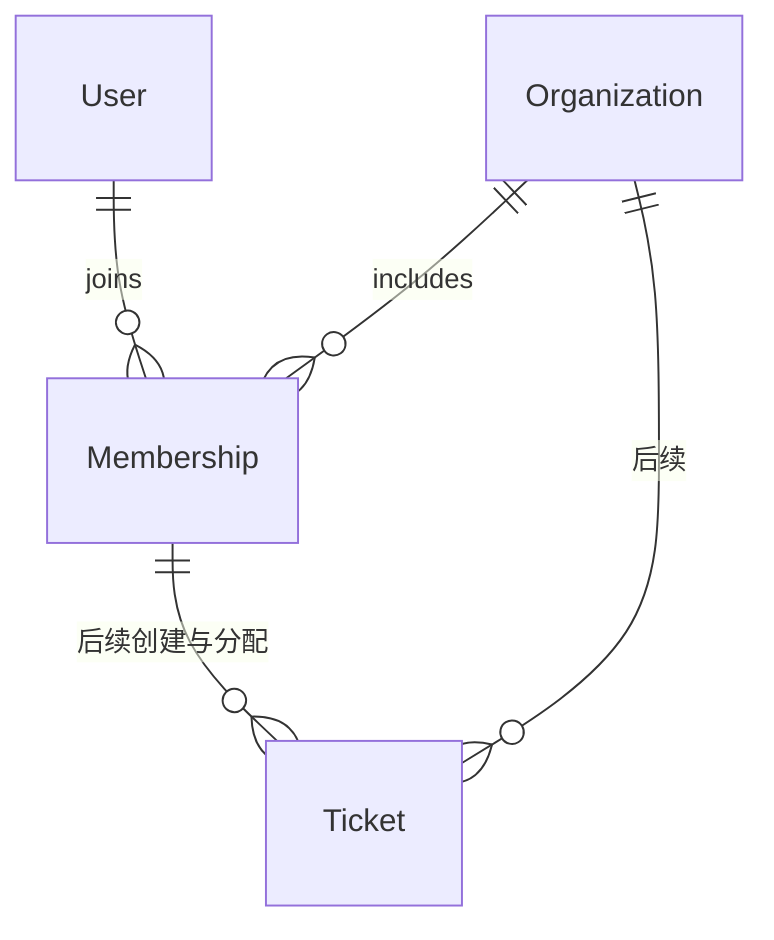

# 数据库设计

## 范围

第一阶段实际 schema 只有 User、Organization、Membership 与 MembershipRole；Tickets、评论、审计和认证凭据仅设计，不提前实现业务。本阶段迁移不包含初始账号或默认密码。

## 初始模型

| 模型         | 主要字段                                               | 约束与含义                                             |
| ------------ | ------------------------------------------------------ | ------------------------------------------------------ |
| User         | id、email、displayName、createdAt、updatedAt           | 全局用户，email 唯一；UUID 主键                        |
| Organization | id、name、slug、createdAt、updatedAt                   | 企业租户，slug 唯一；UUID 主键                         |
| Membership   | id、organizationId、userId、role、createdAt、updatedAt | 用户在企业的成员身份；organizationId + userId 联合唯一 |

用户与组织是多对多关系，由 Membership 承载企业级角色。角色属于成员身份，不能放在全局 User 上：同一人在企业 A 可以是 OWNER，在企业 B 可以是 MEMBER。role 枚举为 OWNER、ADMIN、AGENT、MEMBER，默认 MEMBER。是否允许多个 OWNER、是否限制最后一个 OWNER 离开，需要在第二阶段通过事务和业务规则确定，不由枚举保证。

User email 和 Organization slug 的唯一索引保证全局唯一；后续写入 API 将规范化 email 和 slug，避免大小写形成重复身份。Membership 的联合唯一索引支持按企业查成员，同时为 userId 建立索引以支持查询用户所在企业。外键删除行为采用 Restrict，防止误删组织或用户时级联丢失成员关系。生命周期策略在后续加入归档或软删除前统一设计。

时间使用 timestamptz(3)，以 UTC 存储，前端负责本地化展示。UUID 由 Prisma 的 uuid() 在客户端创建；数据库直接插入时需要显式提供 id。updatedAt 由 Prisma 维护，原生 SQL 写入需自行维护该字段。

## 工单模型规划（未实现）

Ticket 计划包含 id、organizationId、number、title、description、status、priority、creatorMembershipId、assigneeMembershipId（可空）、createdAt、updatedAt、closedAt（可空）。status 将覆盖待处理、处理中、已解决、已关闭；具体状态转换必须在后端验证。number 在 organizationId 下唯一，使用事务分配，不能用总行数生成。

建议列表索引为 `(organizationId, status, createdAt, id)` 与 `(organizationId, assigneeMembershipId, createdAt, id)`，实际加入时依据筛选需求与 EXPLAIN 调整。排序以 createdAt + id 稳定分页，输入分页大小设上限。

Tenant 查询必须把 organizationId 放入 where 条件，更新或删除不能只按 id 查找。创建者和受理者引用 Membership 而非任意 User。后续可为 Membership 增加 `(organizationId, id)` 唯一键，Ticket 用复合外键引用 `(organizationId, creatorMembershipId)` / `(organizationId, assigneeMembershipId)`，从数据库层防止跨租户分配；后端仍需验证成员有效状态及 RBAC。

TicketComment 计划拥有 organizationId、ticketId、authorMembershipId、content 与时间；审计记录同样带 organizationId。评论与工单之间采用带 organizationId 的复合外键，保证不能将企业 A 的评论挂到企业 B 的工单。

## 认证与安全规划

下一阶段引入密码摘要或独立凭据表，禁止存储明文密码。JWT Secret 从环境变量读取；本阶段没有 JWT 变量、令牌签发或登录逻辑。组织选择只能作为客户端请求意图，后端从认证用户与成员关系核验身份。Prisma 客户端必须通过 Service 访问，不能在 Controller 或浏览器中直接使用。

## 迁移工作流

1. `pnpm env:init` 生成本地环境配置，不会覆盖已有文件。
2. `pnpm db:up` 启动 PostgreSQL。
3. `pnpm db:deploy` 应用仓库内的初始迁移。
4. 模型变更时 `pnpm db:migrate --name descriptive_change` 生成开发迁移并审查 SQL。
5. `pnpm db:generate` 重新生成客户端；Prisma 7 不应假定 migrate 会自动生成客户端。

初始迁移从 schema 生成。当前环境没有 Docker，迁移执行和 PostgreSQL 真实连接验证未完成；不能把 schema 校验或模拟就绪测试当作真实数据库验证。已有数据卷修改 POSTGRES_PASSWORD 不会更新数据库内部密码，应使用数据库管理方式修改后同步 DATABASE_URL，不能通过删卷解决。
