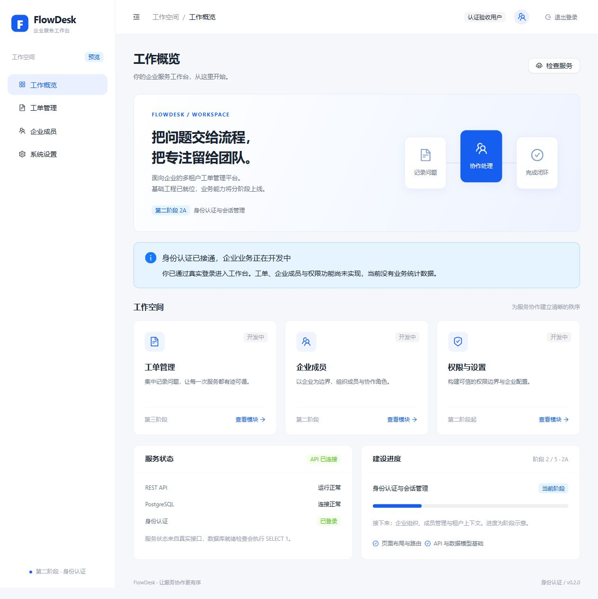

# 第二阶段 2A 验证记录

日期：2026-10-14。范围：数据库验收与身份认证；组织、成员业务、RBAC、工单与 AI 均未开发。

继续执行时重新核对了现有文件和运行状态，并实际重跑 `pnpm check`、`pnpm test:integration`、`pnpm db:deploy`（两次）、`pnpm db:validate` 和 `pnpm install --frozen-lockfile --offline`。结果与以下记录一致。没有丢弃已有改动。

## 数据库证据

本机没有 Docker。使用此前安装在 `.local-tools` 下的独立 PostgreSQL 原生实例，数据在 `.local-db/data`，仅监听 127.0.0.1:5432。开发库为 flowdesk，测试库为 flowdesk_auth_test，凭据来自忽略的环境文件。

- `pnpm db:local:up` 创建此前缺失的开发库与独立测试库；已有集群不重新初始化。
- `pnpm db:deploy` 成功应用初始身份模型与 authentication 两份迁移，再次执行返回 No pending migrations to apply。
- 实际运行 API 的 `/api/v1/health/ready` 返回 200，database=up。
- 真实集成测试验证 Membership 联合唯一约束返回 P2002；无效 userId、organizationId 与删除仍有成员的组织返回 P2003。
- 测试数据使用随机运行前缀，只清理本轮创建的记录，未重置数据库或删除数据卷。
- Docker Compose 容器启动仍未验证，不能将原生数据库结果标记为 Compose 验收通过。

## 自动化检查

`pnpm check` 的 lint、format:check、typecheck、test、build 全部通过。前端 17 个测试、后端 28 个无需外部数据库的测试通过；`pnpm test:integration` 的 12 个真实数据库测试通过，共 57 个通过。普通 test 中的数据库测试明确跳过，不混算为普通测试通过。

真实集成测试覆盖：ready、注册规范化与公开字段、密码/刷新摘要存储、重复注册、登录、无效凭据、DTO 与角色篡改、伪造/过期/错误 issuer/audience/无 exp JWT、轮换与绝对期限、旧令牌重放、并发消费、退出撤销、会话过期、CSRF 与成员关系约束。

前端测试覆盖匿名路由、注册入口、恢复失败、刷新单飞、401 与 503 区分、恢复后查询 me、退出后的迟到响应、新登录与旧恢复竞态、并发业务请求及最大一次重试。数据库故障的 503 HTTP 映射使用测试替身验证，未中断开发数据库冒充真实故障实验。

Jest 的 ExperimentalWarning 与错误分支的 500/503 日志为预期输出。`git diff --check` 通过，环境文件、本地数据目录和生成代码仍被 Git 忽略。

## 浏览器联调

通过本地 Vite 与 NestJS、真实开发 PostgreSQL 执行：新建随机测试账户 → 注册进入工作台 → 刷新页面通过 Cookie 恢复 → 退出回到登录 → 密码登录 → 再次退出。退出后直接访问受保护路由会返回登录页面。

复验时再次在浏览器注册随机本地测试账户，刷新页面恢复身份、退出、密码登录、再次退出，并确认 `/tickets` 返回登录页。生产构建文件中不包含 `/dev-preview` 路由。Vite 代理的 `/api/docs` 返回 200，认证接口调试说明已加入 README。

## 认证链路与取舍

注册时保存 scrypt 密码摘要，建立服务端会话。返回短期 access token，浏览器只将它放在内存；刷新凭据放入 HttpOnly Cookie。业务请求带 Bearer access token，Guard 验证 JWT 后再查询会话，因此退出可立即使旧 JWT 失效。

刷新页面丢失内存 token，浏览器用 Cookie 调用 refresh，再调用 me 恢复用户。数据库保存刷新凭据的 SHA-256 摘要；刷新在事务中锁定会话、消费旧凭据、生成新凭据。重放旧凭据会撤销整个会话。轮换不延长绝对过期时间。

当前选择每次受保护请求查询会话，以换取立即撤销能力。Web Locks 串行化支持浏览器中的 Cookie 操作，BroadcastChannel 同步退出与身份变化；异步响应用操作版本阻止迟到结果重新登录。同标签并发刷新已测试；多标签严格轮换仍可能要求重新登录，未声称覆盖全部浏览器与标签竞态。

## 未完成能力

Docker Compose、线上 HTTPS、生产部署、邮件验证、密码找回、登录限流、会话历史清理、企业成员与租户权限均尚待后续验收。当前身份认证不能证明多租户隔离或完整生产安全。
